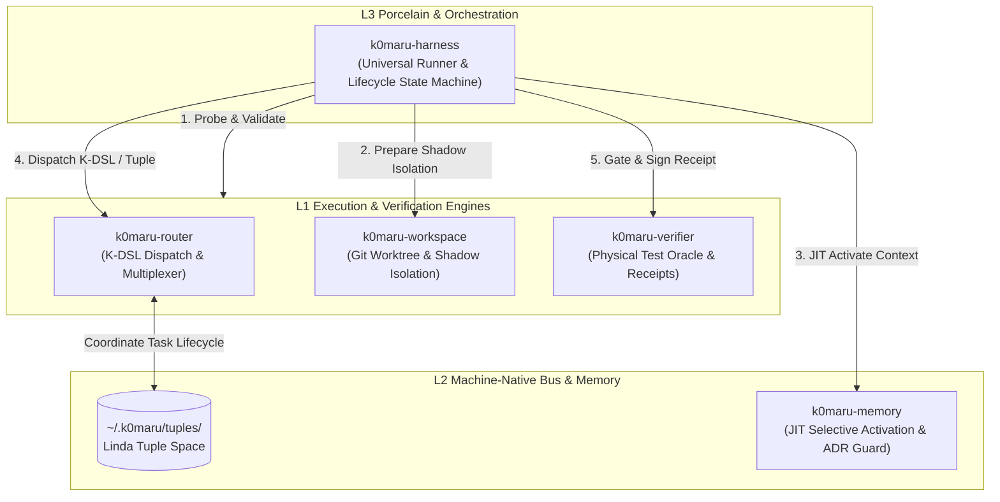

# k0maru-harness

> **Meta-Orchestrator and Universal Lifecycle Harness for K0maru Autonomous Agent Systems**

[](https://github.com/K0maru/k0maru-harness/actions)
[](LICENSE)
[](https://www.rust-lang.org)

`k0maru-harness` is the top-level orchestration CLI and test harness for the K0maru agent ecosystem. Following Unix philosophy and modern AI engineering principles, it coordinates independent decoupled micro-kernels without monolithic compile-time bindings.

---

## 💡 Why k0maru-harness?

Recent empirical research highlights critical vulnerabilities in contemporary AI agent engineering:
1. **AgentSWE Benchmark (arXiv:2610.13361)**: Coding agents building complex agent systems frequently suffer from *Specification Drift* and *Hollow Runtimes*—producing code that appears complete on the surface but lacks true runtime execution, test coverage, or edge-case handling.
2. **ExpActivator (arXiv:2609.33304)**: *"Relevance does not imply applicability."* Statically stuffing voluminous historical memory and docs into prompts creates severe context pollution (90% waste) and degrades single-step execution. Agents need **Just-In-Time (JIT) Experience Activation** at discrete decision points.

`k0maru-harness` resolves these challenges by acting as the **external verifier and runtime coordinator** across the four specialized pillars:



---

## 🏛️ Architecture & The Four Pillars

`k0maru-harness` does **NOT** compile the sub-engines into a monolithic binary, nor does it use Git Submodules. It treats each pillar as an autonomous, independently versioned micro-kernel:

| Pillar Engine | Role & Responsibility | Interface |
| :--- | :--- | :--- |
| **`k0maru-agent-workspace`** | Sandbox and shadow worktree lifecycle management (`wE:pX`) | CLI / Filesystem |
| **`k0maru-agent-memory`** | Local hybrid BM25 + ONNX embedding + JIT recall & Living ADR guard | CLI / MCP / SQLite |
| **`k0maru-agent-router`** | Machine-native K-DSL protocol, Linda Tuple Space, Herdr/tmux routing | CLI / MCP / POSIX |
| **`k0maru-agent-verifier`** | Physical build & test oracle, anti-fake completion receipts (`~/.k0maru/receipts/`) | CLI / Ed25519 Receipts |

---

## 🚀 Quickstart

### Installation

Ensure Rust 1.75+ is installed:

```bash
git clone https://github.com/K0maru/k0maru-harness.git
cd k0maru-harness
cargo build --release
cp target/release/k0maru-harness ~/.local/bin/
```

### 1. Probe Ecosystem Readiness

Inspect all installed pillar binaries, version matrices, and Linda tuple space status:

```bash
k0maru-harness probe
```

Output:
```text
🔍 Probing K0maru Ecosystem Harness Environment...
--------------------------------------------------------------------------------
Binary Components:
  [OK] k0maru-router     : ~/.local/bin/k0maru-router (v0.2.1)
  [OK] k0maru-workspace  : ~/.local/bin/k0maru-workspace (v0.6.0)
  [OK] k0maru-verifier   : ~/.local/bin/k0maru-verifier (v0.4.0)
  [OK] k0maru-memory     : ~/.local/bin/k0maru (v0.11.0)

Buses & State Directories:
  [OK] Linda Tuples      : ~/.k0maru/tuples (Active: 0 tuples)
  [OK] Receipts Outbox   : ~/.k0maru/receipts (Recorded: 1 receipts)
--------------------------------------------------------------------------------
✅ Ecosystem Readiness: All 4 engines installed. System is ready.
```

JSON output is also supported for scripting:
```bash
k0maru-harness probe --json
```

---

## 📜 Development & Quality Gate

```bash
cargo fmt --check
cargo clippy --all-targets -- -D warnings
cargo test
k0maru guard check --diff
```

---

## 📄 License

MIT © [K0maru Project Authors](https://github.com/K0maru)
