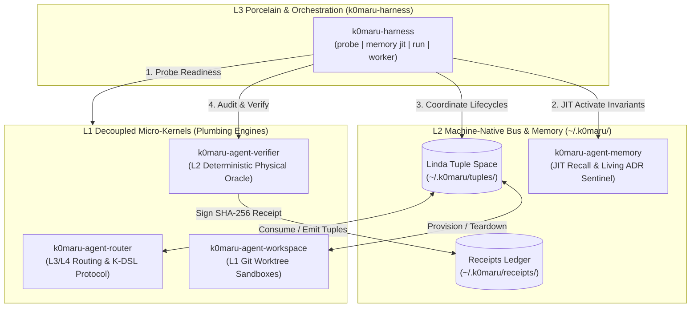

# k0maru-harness

> **Next-Generation Daemonless Meta-Orchestrator and Universal Lifecycle Harness for K0maru Autonomous Agent Systems**

[English](README.md) | [简体中文](README_zh.md)

[](https://github.com/K0maru/k0maru-harness/actions)
[](LICENSE)
[](https://www.rust-lang.org)

`k0maru-harness` is the top-level orchestration CLI and test harness for the K0maru agent ecosystem. Following Unix philosophy and empirical AI engineering research, it coordinates four independent, decoupled micro-kernels without monolithic compile-time bindings or Git submodule entanglements.

---

## 💡 Why k0maru-harness?

Recent empirical research highlights critical vulnerabilities in contemporary AI agent architectures:

1. **AgentSWE Benchmark ([arXiv:2610.13361](https://arxiv.org/abs/2610.13361)) — Eradicating Hollow Runtimes**:  
   When coding agents (Claude, GPT-4, DeepSeek) are tasked with building or refactoring agent architectures, they frequently suffer from **Specification Drift** and **Hollow Runtimes**—producing code that compiles superficially but lacks true runtime execution, test coverage, or edge-case handling, alongside falsified completion reports.  
   *`k0maru-harness` enforces **No-Receipt-No-Merge**: only cryptographically signed execution receipts from `k0maru-verifier` (verifying exit codes, AST scope, and physical test execution) can satisfy the quality gate.*

2. **ExpActivator ([arXiv:2609.33304](https://arxiv.org/abs/2609.33304)) — Just-In-Time (JIT) Experience Activation**:  
   *"Relevance does not imply applicability."* Statically stuffing voluminous historical memories, documentation, and rules into the initial prompt provides at best ~10% utility in step 1, while becoming 90% useless context pollution and attention distraction in subsequent steps.  
   *`k0maru-harness memory jit` queries `k0maru-agent-memory` on-demand at discrete decision points, extracting high-density invariants into a compact **<180 token** injection block, slashing token bloat while improving execution accuracy.*

---

## 🏛️ System Architecture: The Three-Tier Harness



### The Four Pillar Engines

| Pillar Engine | Role & Responsibility | Interface Mode |
| :--- | :--- | :--- |
| **`k0maru-agent-router`** | Machine-native K-DSL protocol, Linda Tuple Space coordinator, and terminal multiplexer injection (`herdr`/`tmux`). | POSIX CLI / Linda Tuples |
| **`k0maru-agent-workspace`** | Sandbox isolation and ephemeral Git worktree lifecycle manager (`wE:pX`). | POSIX CLI / Git Worktrees |
| **`k0maru-agent-verifier`** | Deterministic physical build & test oracle, anti-fake completion receipts (`~/.k0maru/receipts/`). | POSIX CLI / SHA-256 Receipts |
| **`k0maru-agent-memory`** | Local hybrid BM25 + ONNX embedding, JIT invariant recall, and Living ADR architectural guard. | FastMCP / POSIX CLI / SQLite |

---

## 🚀 Quickstart

### Installation

Requires **Rust 1.75+**:

```bash
git clone https://github.com/K0maru/k0maru-harness.git
cd k0maru-harness
cargo build --release
cp target/release/k0maru-harness ~/.local/bin/
```

Verify installation:
```bash
k0maru-harness --version
# Output: k0maru 0.1.0
```

---

## 🛠️ CLI Commands & Usage

### 1. Ecosystem Readiness Probe (`k0maru-harness probe`)

Probes all 4 decoupled micro-kernel binaries in `PATH`, verifies their versions and operational status, and audits write permissions to local Linda tuple space and receipt ledgers:

```bash
k0maru-harness probe
```

```text
🔍 [K0maru-Harness] Component & Bus Readiness Probe
═══════════════════════════════════════════════════════════════════
  Timestamp: 2026-10-13T09:31:46.879454+00:00

📦 Decoupled Micro-Kernels (Pillars):
  ✅ Router     [REQUIRED] ~/.local/bin/k0maru-router     -> k0maru-router 0.1.0
  ✅ Workspace  [OPTIONAL] ~/.local/bin/k0maru-workspace  -> installed (operational)
  ✅ Verifier   [OPTIONAL] ~/.local/bin/k0maru-verifier   -> k0maru-verifier 0.1.0
  ✅ Memory     [OPTIONAL] ~/.local/bin/k0maru            -> k0maru 0.11.0

🚌 Local Event & Evidence Buses:
  📁 Linda Tuple Space            -> ~/.k0maru/tuples    [OK (Writable)]
  📁 Execution Receipts Ledger    -> ~/.k0maru/receipts  [OK (Writable)]
───────────────────────────────────────────────────────────────────
🎉 Harness status: READY FOR AUTONOMOUS DISPATCH
═══════════════════════════════════════════════════════════════════
```

Machine-readable JSON is supported for CI and subagents:
```bash
k0maru-harness probe --json
```

---

### 2. JIT Experience & Invariant Activation (`k0maru-harness memory jit`)

Retrieves relevant constraints, ADR invariants, or testing guidelines for a specific decision point (e.g. `git branching`, `sqlite lock`, `api pagination`) and formats them into a compact, high-density prompt fragment (<180 tokens):

```bash
k0maru-harness memory jit --decision "git branching"
```

```markdown
### 🧠 [JIT Invariant Activation: git branching]
- [[30_Resources/lancedb-docs/02_Core_Capabilities_and_Guides/03_branching_tagging_and_time_travel.md]] (🌿 Git 级表分支、标签与时间旅行): # 🌿 Git 级表分支、标签与时间旅行 在传统生产数据库中，对线上千万级数据集执行复杂的实验性写入...
- [[30_Resources/lancedb-docs/01_Overview_and_Quickstart/03_lance_columnar_format_and_storage.md]] (🧬 Lance 列式存储格式规范与零拷贝演进): ...擎 | **零拷贝追加 (Zero-Copy Column Addition)** | | **就地原地更新与分支** | 写放大严重 | 支持 Row-level Delete/Merge | **Git 级表分支 (Table Branching) 与快照** | ...
```

Machine-readable structured JSON:
```bash
k0maru-harness memory jit --decision "git branching" --limit 2 --json
```

---

### 3. Pipeline Runner & Worker Loop (Phases 3 & 4)

```bash
# Run a task end-to-end through sandbox provisioning, dispatch, and physical verification
k0maru-harness run "Refactor auth token expiration" --domain AUTH-SRV --verify

# Start an autonomous worker loop claiming TASK_READY tuples from Linda space
k0maru-harness worker --domain HARNESS --once
```

---

## 🤖 How to Enable Autonomous Invocations by AI Agents

To ensure AI coding agents (Antigravity, Claude Code, Cursor, Windsurf) proactively call `k0maru-harness`, apply the following patterns:

### 1. Invariant Contract in `AGENTS.md` / System Prompt
Declare non-negotiable execution steps in the project's constitution:
```markdown
## ⚡ K0maru-Harness Invariant Rules
1. **Decision Gate (Anti-Context Bloat)**: Before implementing architectural patterns, concurrency locks, or git flows, ALWAYS execute `k0maru-harness memory jit --decision "<topic>"` to retrieve concise JIT invariants instead of pasting large markdown docs.
2. **Environment Preflight**: Before dispatching multi-step workflows, run `k0maru-harness probe` to verify ecosystem pillar readiness.
3. **Hard Verification**: Never claim a task complete without `k0maru-verifier verify` generating a green cryptographic receipt.
```

### 2. FastMCP Tooling Integration
Register `k0maru-harness` subcommands as MCP tools in `~/.gemini/antigravity-cli/mcp/` or Claude Code's `claude_desktop_config.json`:
- `k0maru_harness_probe`: Run readiness probe.
- `k0maru_harness_jit`: Retrieve JIT invariants for a decision point.

### 3. Antigravity Skill Binding
Leverage the built-in `k0maru-harness` skill (`~/.gemini/config/skills/k0maru-harness/SKILL.md`) which instructs agents on end-to-end task lifecycles, Linda tuple claiming, and physical verification gates.

---

## 📐 Quality Gates

All commits and PRs must satisfy the zero-tolerance quality baseline:

```bash
cargo fmt --all --check
cargo clippy --all-targets -- -D warnings
cargo test
k0maru guard check --diff
```

---

## 📄 License

MIT © [K0maru Project Authors](https://github.com/K0maru)
