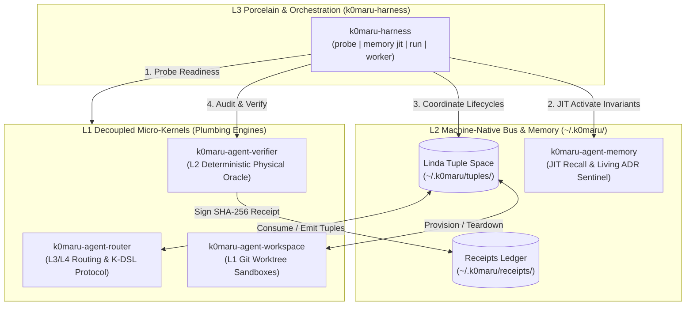

# k0maru-harness

> **Next-Generation Daemonless Meta-Orchestrator and Universal Lifecycle Harness for K0maru Autonomous Agent Systems**

[English](README.md) | [简体中文](README_zh.md)

[](https://github.com/K0maru/k0maru-harness/actions)
[](LICENSE)
[](https://www.rust-lang.org)

`k0maru-harness` is the top-level orchestration CLI and test harness for the K0maru agent ecosystem. Following Unix philosophy and empirical AI engineering research, it coordinates four independent, decoupled micro-kernels without monolithic compile-time bindings or Git submodule entanglements.

---

## 💡 Why k0maru-harness?

Recent empirical research highlights critical vulnerabilities in contemporary AI agent architectures:

1. **AgentSWE Benchmark ([arXiv:2610.13361](https://arxiv.org/abs/2610.13361)) — Eradicating Hollow Runtimes**:  
   When coding agents (Claude, GPT-4, DeepSeek) are tasked with building or refactoring agent architectures, they frequently suffer from **Specification Drift** and **Hollow Runtimes**—producing code that compiles superficially but lacks true runtime execution, test coverage, or edge-case handling, alongside falsified completion reports.  
   *`k0maru-harness` enforces **No-Receipt-No-Merge**: only cryptographically signed execution receipts from `k0maru-verifier` (verifying exit codes, AST scope, and physical test execution) can satisfy the quality gate.*

2. **ExpActivator ([arXiv:2609.33304](https://arxiv.org/abs/2609.33304)) — Just-In-Time (JIT) Experience Activation**:  
   *"Relevance does not imply applicability."* Statically stuffing voluminous historical memories, documentation, and rules into the initial prompt provides at best ~10% utility in step 1, while becoming 90% useless context pollution and attention distraction in subsequent steps.  
   *`k0maru-harness memory jit` queries `k0maru-agent-memory` on-demand at discrete decision points, extracting high-density invariants into a compact **<180 token** injection block, slashing token bloat while improving execution accuracy.*

3. **Popperian Physical Falsification (`--red-check`) — Defeating 'Fake Green' Tests**:  
   Inspired by Popperian scientific epistemology and autonomous testing paradigms ([Magpie](https://github.com/yetone/magpie)), agents commonly generate tautological tests or mocks that pass regardless of code correctness.  
   *`k0maru-verifier --red-check` temporarily restores production files to baseline to verify that new tests fail on unmodified code before validating they pass on the new implementation.*

4. **Dynamic Error Notebook (`LESSONS.md`) & Seen 3× Promotion**:  
   Rather than manual documentation overhead, transient agent failure modes are recorded dynamically in `LESSONS.md`. Any empirical lesson observed **3 times** is automatically promoted to a permanent Living ADR architectural invariant.

---

## 🏛️ System Architecture: The Three-Tier Harness



### The Four Pillar Engines

| Pillar Engine | Role & Responsibility | Interface Mode |
| :--- | :--- | :--- |
| **`k0maru-agent-router`** | Machine-native K-DSL protocol, Linda Tuple Space coordinator, and terminal multiplexer injection (`herdr`/`tmux`). | POSIX CLI / Linda Tuples |
| **`k0maru-agent-workspace`** | Sandbox isolation and ephemeral Git worktree lifecycle manager (`wE:pX`). | POSIX CLI / Git Worktrees |
| **`k0maru-agent-verifier`** | Deterministic physical build & test oracle, anti-fake completion receipts (`~/.k0maru/receipts/`). | POSIX CLI / SHA-256 Receipts |
| **`k0maru-agent-memory`** | Local hybrid BM25 + ONNX embedding, JIT invariant recall, and Living ADR architectural guard. | FastMCP / POSIX CLI / SQLite |

---

## 🚀 Quickstart

### Installation

Requires **Rust 1.75+**:

```bash
git clone https://github.com/K0maru/k0maru-harness.git
cd k0maru-harness
cargo build --release
cp target/release/k0maru-harness ~/.local/bin/
```

Verify installation:
```bash
k0maru-harness --version
# Output: k0maru-harness 0.1.0
```

---

## 🛠️ CLI Commands & Usage

### 1. Ecosystem Readiness Probe (`k0maru-harness probe`)

Probes all 4 decoupled micro-kernel binaries in `PATH`, verifies their versions and operational status, and audits write permissions to local Linda tuple space and receipt ledgers:

```bash
k0maru-harness probe
```

```text
🔍 [K0maru-Harness] Component & Bus Readiness Probe
═══════════════════════════════════════════════════════════════════
  Timestamp: 2026-10-14T04:12:49.623945+00:00

📦 Decoupled Micro-Kernels (Pillars):
  ✅ Router     [REQUIRED] ~/.local/bin/k0maru-router     -> k0maru-router 0.1.0
  ✅ Workspace  [OPTIONAL] ~/.local/bin/k0maru-workspace  -> installed (operational)
  ✅ Verifier   [OPTIONAL] ~/.local/bin/k0maru-verifier   -> k0maru-verifier 0.1.0
  ✅ Memory     [OPTIONAL] ~/.local/bin/k0maru            -> k0maru 0.11.0

🚌 Local Event & Evidence Buses:
  📁 Linda Tuple Space            -> ~/.k0maru/tuples    [OK (Writable)]
  📁 Execution Receipts Ledger    -> ~/.k0maru/receipts  [OK (Writable)]
───────────────────────────────────────────────────────────────────
🎉 Harness status: READY FOR AUTONOMOUS DISPATCH
═══════════════════════════════════════════════════════════════════
```

Machine-readable JSON is supported for CI and subagents:
```bash
k0maru-harness probe --json
```

---

### 2. JIT Experience Activation & Seen-3× Lesson Engine (`k0maru-harness memory`)

#### Namespace-Isolated JIT Recall (`memory jit`)
Retrieves relevant constraints, ADR invariants, or `LESSONS.md` entries for a specific decision point while strictly filtering out noise namespaces (`30_Resources/`, `00_Daily/`, `01_AI_Logs/`, `Archive_Legacy/`), formatting them into a compact prompt fragment (<180 tokens):

```bash
k0maru-harness memory jit --decision "git branching"
```

```markdown
### 🧠 [JIT Invariant Activation: git branching]
- [[LESSONS.md]] (2. 生产发布流水线严禁开启取消进行中任务 (cancel-in-progress)): **做对的标准 (Done right)**：打 Tag 之前，对应的 Commit CI 必须全量跑完且全绿，被后续推送抢占中断的测试结果一律作废。
- [[LESSONS.md]] (4. 严禁在多智能体自主协作体系中使用 Git Submodules): **做对的标准 (Done right)**：跨组件通过 POSIX 进程调用、Exit Code 与 Linda 状态空间解耦协调。
- [[LESSONS.md]] (5. 严禁向智能体长上下文暴力倾倒前置大文档 (Relevance != Applicability)): **做对的标准 (Done right)**：平时保持 Prompt 极简，仅在特定的决策点（如 Git 分支、锁、数据库调优）调用 `k0maru-harness memory jit` 提取 <180 Token 的纯粹状态约束。
```

Machine-readable structured JSON:
```bash
k0maru-harness memory jit --decision "git branching" --limit 2 --json
```

#### Dynamic Error Notebook & Seen-3× Promotion (`memory record-lesson`)
Records or increments empirical agent failure lessons in `LESSONS.md`. When a lesson reaches `Seen 3×`, it is automatically promoted to `**[PROMOTED TO LIVING ADR]**`:

```bash
k0maru-harness memory record-lesson \
  --title "跨工作区任务派发必须优先探测并路由至 Herdr 活跃窗格而非原地派生" \
  --cause "主控 Agent 受默认工具惯性影响直接调用宿主内置 subagent" \
  --standard "跨仓任务一律通过 k0maru-router route / k0maru-harness run 路由至目标仓库驻留的 Herdr 窗格 Agent"
```

---

### 3. Pipeline Runner (`k0maru-harness run`)

Orchestrates a complete task through pre-flight probe, JIT invariant activation, auto-driver Herdr/tmux pane probing & Linda space tuple emission, optional subprocess execution (`--exec` with `K0MARU_TASK_ID` and `K0MARU_JIT_INVARIANTS` injected), physical verification (`--red-check`), and `TASK_COMPLETED` tuple settlement:

```bash
# Standard pipeline run
k0maru-harness run "Implement user authentication with JWT" --domain AUTH-SRV

# Execute with worker subprocess and Popperian physical falsification
k0maru-harness run "Implement user authentication with JWT" \
  --domain AUTH-SRV \
  --exec "cargo test" \
  --red-check
```

```text
🚀 [K0maru-Harness] Task Pipeline Execution
═══════════════════════════════════════════════════════════════════
  Task ID:      TASK-20261014042439
  Task:         Implement user authentication with JWT
  Domain:       AUTH-SRV
  Node:         localhost (local)
  Workspace:    .

  🔍 Phase 1: Component Readiness Probe -> [READY]
  🧠 Phase 2: JIT Invariant Activation  -> Activated (4 lines)
  🚌 Phase 3: Linda Space Task Ready     -> [EMITTED] (tup_ccdf3ef16ef3442190d7df5d29cf7247)
  ⚙️  Phase 3.5: Subprocess Execution    -> [PASSED]
  🛡️  Phase 4: Physical Verification     -> [VERIFIED] (Verdict: success, tests: 30/30 passed, red-check: passed)
  🏁 Phase 5: Linda Space Settlement    -> [SETTLED] (TASK_COMPLETED)
═══════════════════════════════════════════════════════════════════
```

Machine-readable JSON and compact single-line K-DSL wire (`--wire`) outputs (verbose child logs are automatically sunk to `~/.k0maru/logs/<task_id>.log`, and any subprocess or verification failure is automatically recorded into `LESSONS.md` as `|lesson:Seen_Nx`):
```bash
k0maru-harness run "Implement user authentication with JWT" --domain AUTH-SRV --json
k0maru-harness run "Implement user authentication with JWT" --domain AUTH-SRV --wire
# !Σ:PIPELINE|TASK-20261014055930-001-0|probe:OK|exec:PASS|verify:PASS|settled:true|log:~/.k0maru/logs/...|receipt:...|lesson:NONE

# Inspect cryptographic execution receipt in compact K-DSL wire format (<160 chars)
k0maru-harness receipt TICK-005
# !Σ:RECEIPT|TICK-005|status:PASS|red_check:PASS|commit:HEAD|sig:e3b0c44298fc
```

---

### 4. Deterministic Pre-Commit Hook Installer (`k0maru-harness init-hook`)

Installs a deterministic physical pre-commit hook into `.git/hooks/pre-commit` that blocks any commit violating code formatting or Living ADR architectural invariants, providing instant self-healing guidance:

```bash
# Install in current repository
k0maru-harness init-hook

# Install in custom repository path
k0maru-harness init-hook --path ~/workspace/my-repo
```

---

## 🤖 How to Enable Autonomous Invocations by AI Agents

To ensure AI coding agents (Antigravity, Claude Code, Cursor, Windsurf) proactively call `k0maru-harness`, apply the following patterns:

### 1. Invariant Contract in `AGENTS.md` / System Prompt
Declare non-negotiable execution steps in the project's constitution:
```markdown
## ⚡ K0maru-Harness Invariant Rules
1. **Decision Gate (Anti-Context Bloat)**: Before implementing architectural patterns, concurrency locks, or git flows, ALWAYS execute `k0maru-harness memory jit --decision "<topic>"` to retrieve concise JIT invariants instead of pasting large markdown docs.
2. **Environment Preflight**: Before dispatching multi-step workflows, run `k0maru-harness probe` to verify ecosystem pillar readiness.
3. **Hard Verification**: Never claim a task complete without `k0maru-verifier verify` generating a green cryptographic receipt.
```

### 2. FastMCP Tooling Integration
Register `k0maru-harness` subcommands as MCP tools in `~/.gemini/antigravity-cli/mcp/` or Claude Code's `claude_desktop_config.json`:
- `k0maru_harness_probe`: Run readiness probe.
- `k0maru_harness_jit`: Retrieve JIT invariants for a decision point.

### 3. Antigravity Skill Binding
Leverage the built-in `k0maru-harness` skill (`~/.gemini/config/skills/k0maru-harness/SKILL.md`) which instructs agents on end-to-end task lifecycles, Linda tuple claiming, and physical verification gates.

---

## 📐 Quality Gates

All commits and PRs must satisfy the zero-tolerance quality baseline:

```bash
cargo fmt --all --check
cargo clippy --all-targets -- -D warnings
cargo test
k0maru guard check --diff
```

---

## 📄 License

MIT © [K0maru Project Authors](https://github.com/K0maru)
