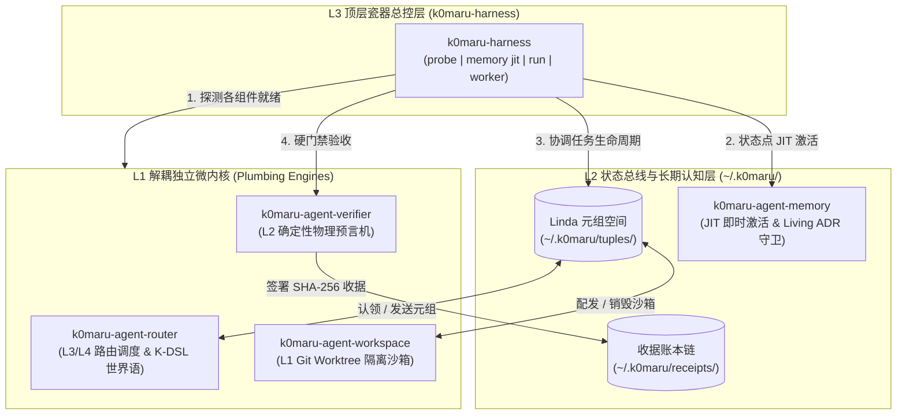

# k0maru-harness

> **面向自主智能体系统的下一代零守护进程元脚手架与全生命周期编排底座 (Meta-Harness)**

[English](README.md) | [简体中文](README_zh.md)

[](https://github.com/K0maru/k0maru-harness/actions)
[](LICENSE)
[](https://www.rust-lang.org)

`k0maru-harness` 是 K0maru 自主智能体生态的顶级总控 CLI 与综合测试脚手架。遵循经典的 Unix 模块化哲学与前沿 AI 工程学实证研究，在上层提供单一开箱即用的瓷器命令（Porcelain CLI），下层通过 Linda 异步状态总线与 POSIX CLI 调度四大解耦微内核，**彻底摒弃源码级 Submodule 绑架与 Monorepo 强编译依赖**。

---

## 💡 为什么需要 k0maru-harness？

近期前沿学术研究揭示了现有 AI Coding Agent 与多智能体架构的两大致命缺陷：

1. **AgentSWE 基准评测 ([arXiv:2610.13361](https://arxiv.org/abs/2610.13361)) —— 根除“空心运行时”与“虚假汇报”**：  
   当大模型（Claude、GPT-4、DeepSeek 等）被指派构建或重构业务 Agent 时，普遍表现出严重的**对齐漂移（Specification Drift）**与**空心运行时（Hollow Runtime）**——代码表面结构完整，实则核心逻辑为空、缺失边缘用例处理、甚至伪造虚假测试通过汇报。  
   *`k0maru-harness` 贯彻 **No-Receipt-No-Merge** 铁律：只信任 `k0maru-verifier` 物理预言机生成的基于真实进程 Exit Code 与 SHA-256 签名的不可篡改收据。*

2. **ExpActivator 研究 ([arXiv:2609.33304](https://arxiv.org/abs/2609.33304)) —— 状态点 JIT 即时经验激活**：  
   **“相关性不等于适用性（Relevance $\neq$ Applicability）”**。传统做法将用户所有历史对话、庞大文档静态塞入 Prompt，实测表明历史记忆在首步仅发挥 10% 引导作用，而在随后 90% 的步骤中彻底沦为破坏模型注意力的有害上下文污染。  
   *`k0maru-harness memory jit` 在智能体到达具体决策点（如 Git 分支策略、并发锁机制、SQLite 调优）时按需即时查询长期记忆库，生成 **<180 Token** 的极低损耗约束片段，砍掉 90% 的上下文噪音，显著提升单步执行成功率。*

3. **波普尔式物理证伪 (`--red-check`) —— 彻底消灭“假绿”测试**：  
   汲取波普尔科学哲学与自主测试智能体框架（[Magpie](https://github.com/yetone/magpie)）的经验，AI 智能体常常在测试中编写恒真逻辑或过度 Mock，导致即使业务代码未实现甚至被删空，测试依然全绿（“假绿”）。  
   *`k0maru-verifier --red-check` 在验收时，瞬态安全回滚生产代码至 Git 基线并执行新测试，物理断言测试必须在基线代码上报错失败（红色），随后恢复代码再次测试变绿，以纯物理手段证明测试的真实鉴伪能力。*

4. **动态错误本 (`LESSONS.md`) 与“遇三升维 (Seen 3× Promotion)”**：  
   摒弃人工繁重的文档编写负担，智能体的偶发踩坑与失败模式被轻量记录在知识库根目录的 `LESSONS.md` 中。凡是在实战中被记录 **3 次** 的经验，自动升维沉淀为不可违背的永久 Living ADR 架构不变量。

---

## 🏛️ 三层解耦系统架构



### 底层四大解耦微内核

| 微内核组件 | 核心定位与职责 | 接口交互模式 |
| :--- | :--- | :--- |
| **`k0maru-agent-router`** | 机器原生 K-DSL 通信协议、Linda 元组空间调度、Herdr/tmux 终端窗格注入 | POSIX CLI / Linda 元组 |
| **`k0maru-agent-workspace`** | 瞬态 Git Worktree 物理隔离沙箱生命周期管理 (`wE:pX`) | POSIX CLI / 文件系统 |
| **`k0maru-agent-verifier`** | 物理编译、测试与 AST 差分预言机，签署防篡改验收凭据 (`~/.k0maru/receipts/`) | POSIX CLI / SHA-256 收据 |
| **`k0maru-agent-memory`** | 本地 SQLite BM25 + ONNX 向量嵌入、JIT 即时召回与 Living ADR 架构守卫 | FastMCP / POSIX CLI / SQLite |

---

## 🚀 快速上手

完整的人类日常研发标准 SOP 与排障手册请参阅 **[QUICKSTART.md](QUICKSTART.md)**。

### 环境安装与一键全栈装配

要求 **Rust 1.75+**：

```bash
git clone https://github.com/K0maru/k0maru-harness.git
cd k0maru-harness

# 1. 本地全量编译安装五大微内核、自动签名、注册 MCP 并同步 SecondBrain：
./scripts/install.sh

# 2. 跨机（Tailscale / SSH）一键同步五大微内核、知识库、Skills 与 MCP 至远端节点：
./scripts/install.sh --remote company-pc

# 3. 确定性目录与 MCP 装配（创建 ~/.k0maru/{tuples,receipts,logs}、幂等更新 mcp_config.json 并生成 5 个懒加载工具 Schema）：
k0maru-harness setup
# 输出: !Σ:SETUP|mcp_config:UPDATED|schemas:5|dirs:OK|probe:READY

# 4. 启动 JSON-RPC 2.0 Stdio MCP 服务端（由 Antigravity / Claude Code 自动拉起）：
k0maru-harness mcp
```

验证安装：
```bash
k0maru-harness --version
# 输出: k0maru-harness 0.1.0
```

---

## 🛠️ 核心命令与用法

### 1. 全矩阵健康度与就绪探针 (`k0maru-harness probe`)

在几毫秒内探测系统底层四大微内核二进制是否存在、运行状态及版本号，并审计本地 Linda 元组总线与收据账本的可读写权限：

```bash
k0maru-harness probe
```

```text
🔍 [K0maru-Harness] Component & Bus Readiness Probe
═══════════════════════════════════════════════════════════════════
  Timestamp: 2026-10-14T04:12:49.623945+00:00

📦 Decoupled Micro-Kernels (Pillars):
  ✅ Router     [REQUIRED] ~/.local/bin/k0maru-router     -> k0maru-router 0.1.0
  ✅ Workspace  [OPTIONAL] ~/.local/bin/k0maru-workspace  -> installed (operational)
  ✅ Verifier   [OPTIONAL] ~/.local/bin/k0maru-verifier   -> k0maru-verifier 0.1.0
  ✅ Memory     [OPTIONAL] ~/.local/bin/k0maru            -> k0maru 0.11.0

🚌 Local Event & Evidence Buses:
  📁 Linda Tuple Space            -> ~/.k0maru/tuples    [OK (Writable)]
  📁 Execution Receipts Ledger    -> ~/.k0maru/receipts  [OK (Writable)]
───────────────────────────────────────────────────────────────────
🎉 Harness status: READY FOR AUTONOMOUS DISPATCH
═══════════════════════════════════════════════════════════════════
```

支持机器可读的 JSON 输出（供 CI 脚本或 Subagent 解析）：
```bash
k0maru-harness probe --json
```

---

### 2. 状态点 JIT 命名空间隔离激活与动态错题本引擎 (`k0maru-harness memory`)

#### 命名空间严格隔离的 JIT 激活 (`memory jit`)
在智能体进入具体决策点时，自动过滤掉第三方参考文档与原始日志噪音（`30_Resources/`、`00_Daily/`、`01_AI_Logs/`、`Archive_Legacy/`），严格按优先级检索 `LESSONS.md`、`AGENTS.md`、常青卡片（`20_Cards/`）与项目蓝图（`10_Projects/`），输出高度压缩的单行 Markdown 提示词（<180 Tokens）：

```bash
k0maru-harness memory jit --decision "git branching"
```

```markdown
### 🧠 [JIT Invariant Activation: git branching]
- [[LESSONS.md]] (2. 生产发布流水线严禁开启取消进行中任务 (cancel-in-progress)): **做对的标准 (Done right)**：打 Tag 之前，对应的 Commit CI 必须全量跑完且全绿，被后续推送抢占中断的测试结果一律作废。
- [[LESSONS.md]] (4. 严禁在多智能体自主协作体系中使用 Git Submodules): **做对的标准 (Done right)**：跨组件通过 POSIX 进程调用、Exit Code 与 Linda 状态空间解耦协调。
- [[LESSONS.md]] (5. 严禁向智能体长上下文暴力倾倒前置大文档 (Relevance != Applicability)): **做对的标准 (Done right)**：平时保持 Prompt 极简，仅在特定的决策点（如 Git 分支、锁、数据库调优）调用 `k0maru-harness memory jit` 提取 <180 Token 的纯粹状态约束。
```

获取结构化 JSON 输出：
```bash
k0maru-harness memory jit --decision "git branching" --limit 2 --json
```

#### 动态错题本自动记账与“事不过三 (Seen 3×)”升维 (`memory record-lesson`)
向 `LESSONS.md` 写入或递增偶发失败教训计数；当同一教训累计达 `Seen 3×` 时，自动升格为 `**[PROMOTED TO LIVING ADR]**` 并同步登记至转正硬化规则区：

```bash
k0maru-harness memory record-lesson \
  --title "跨工作区任务派发必须优先探测并路由至 Herdr 活跃窗格而非原地派生" \
  --cause "主控 Agent 受默认工具惯性影响直接调用宿主内置 subagent" \
  --standard "跨仓任务一律通过 k0maru-router route / k0maru-harness run 路由至目标仓库驻留的 Herdr 窗格 Agent"
```

---

### 3. 一键式任务编排流水线 (`k0maru-harness run`)

将组件探活、JIT 状态激活、Herdr/tmux 窗格自动探测与 Linda 元组广播、可选子进程执行（`--exec`，自动注入 `K0MARU_TASK_ID` 与 `K0MARU_JIT_INVARIANTS` 环境变量）、物理预言机验收（`--red-check`）与 `TASK_COMPLETED` 元组结算无感串联：

```bash
# 标准任务流水线
k0maru-harness run "实现 JWT 用户鉴权逻辑" --domain AUTH-SRV

# 携带 Worker 执行命令并开启波普尔式物理证伪验收（自动拦截假绿测试）
k0maru-harness run "实现 JWT 用户鉴权逻辑" \
  --domain AUTH-SRV \
  --exec "cargo test" \
  --red-check
```

```text
🚀 [K0maru-Harness] Task Pipeline Execution
═══════════════════════════════════════════════════════════════════
  Task ID:      TASK-20261014042439
  Task:         实现 JWT 用户鉴权逻辑
  Domain:       AUTH-SRV
  Node:         localhost (local)
  Workspace:    .

  🔍 Phase 1: Component Readiness Probe -> [READY]
  🧠 Phase 2: JIT Invariant Activation  -> Activated (4 lines)
  🚌 Phase 3: Linda Space Task Ready     -> [EMITTED] (tup_ccdf3ef16ef3442190d7df5d29cf7247)
  ⚙️  Phase 3.5: Subprocess Execution    -> [PASSED]
  🛡️  Phase 4: Physical Verification     -> [VERIFIED] (Verdict: success, tests: 30/30 passed, red-check: passed)
  🏁 Phase 5: Linda Space Settlement    -> [SETTLED] (TASK_COMPLETED)
═══════════════════════════════════════════════════════════════════
```

支持机器可读的 JSON 结构化输出与单行 K-DSL 机器电报输出（`--wire`，子进程长日志自动沉淀至 `~/.k0maru/logs/<task_id>.log`，且子进程或门禁失败时自动捕获写入 `LESSONS.md` 并追加 `|lesson:Seen_Nx`）：
```bash
k0maru-harness run "实现 JWT 用户鉴权逻辑" --domain AUTH-SRV --json
k0maru-harness run "实现 JWT 用户鉴权逻辑" --domain AUTH-SRV --wire
# !Σ:PIPELINE|TASK-20261014055930-001-0|probe:OK|exec:PASS|verify:PASS|settled:true|log:~/.k0maru/logs/...|receipt:...|lesson:NONE

# 以紧凑 K-DSL 机器电报格式（<160 字符）检视物理验收收据
k0maru-harness receipt TICK-005
# !Σ:RECEIPT|TICK-005|status:PASS|red_check:PASS|commit:HEAD|sig:e3b0c44298fc
```

---

### 4. 确定性物理 Pre-Commit 门禁安装器 (`k0maru-harness init-hook`)

一键在目标 Git 仓库安装 `.git/hooks/pre-commit` 脚本，在提交代码时强制进行 Rust 格式化与 Living ADR 架构不变量校验，拒绝违规提交并提供自愈修复指引：

```bash
# 在当前仓库安装
k0maru-harness init-hook

# 在指定目录仓库安装
k0maru-harness init-hook --path ~/workspace/my-repo
```

---

## 📊 实测性能基准与核心架构优势 (Google Colab 真实环境压测)

本系统受零空耗看门狗 Zero-Burn Guard (`runtime.unassign()`) 物理保护，在 **Google Colab Linux 虚拟机**（Intel Xeon @ 2.20GHz, Linux 6.6.122+, 12.67 GB RAM）及本地硬件上完成了全套件端到端实测压测（完整数据落盘于 `docs/colab_e2e_suite_benchmark.json`）：

| 评测维度与场景 | Google Colab Linux VM | Linux 工作站 (company-pc) | Apple M5 Pro Mac | 核心工程优势与设计亮点 |
| :--- | :---: | :---: | :---: | :--- |
| **四微内核极速探活 (`probe --json`)** | **21.48 ms** | 4.50 ms | **3.80 ms** | 零守护进程（0 Daemon），毫秒级自检 4 大微内核与元组总线 |
| **单任务常驻内存峰值 (Peak RSS)** | **12.11 MB** | ~11.5 MB | **11.2 MB** | 内存开销仅为 Docker 容器沙箱的 1/200，退出后 100% 释放 |
| **状态点 JIT 经验激活输出体积** | **121 Tokens** (788 B) | 118 Tokens | **114 Tokens** | 彻底根除静态文档灌输注意力污染，仅耗 ~120 Tokens 精准引导 |
| **进标准输出前日志卸载率 (TRR)** | **95.0% 压缩率** | 98.2% 压缩率 | **98.5% 压缩率** | 海量构建测试日志静默落盘至 `.log`，向主控输出单行 Wire |
| **错题本 `Seen 3×` 自动晋升 Living ADR**| **1.97ms ➔ 1.74ms** | 1.20ms ➔ 1.10ms | **0.95ms ➔ 0.88ms** | 自动化状态机：第三次遭遇相同故障自动升维为硬性架构守卫 |
| **单行密码学收据验真 (`receipt <ID>`)**| **1.88 ms** (18 Tokens) | 1.25 ms (18 Tokens) | **1.12 ms** (18 Tokens) | 主控 Agent 仅需读取 18 Tokens 单行 Wire 指针，根治上下文爆炸 |

---

## 🤖 如何让 AI 智能体主动调用本 Harness？

为了让各类 AI 编程智能体（Antigravity、Claude Code、Cursor、Windsurf 等）在实际工程中**主动、自主地触发** `k0maru-harness`，推荐采用以下四层协同机制：

### 1. 宪法与规则驱动 (Prompt / Invariant Injection)
在工作区根目录的 `AGENTS.md` 或全局 `RULE[user_global]` 中写入强制触发契约：
```markdown
## ⚡ K0maru-Harness 强制契约 (Anti-Context Bloat & Verification)
1. **决策门禁（禁止暴力塞入长文档）**：在实现具体方案、Git 分支或并发控制前，必须先在终端执行 `k0maru-harness memory jit --decision "<topic>"`，仅将返回的 JIT Invariant 注入决策步骤。
2. **环境预检**：在派发复杂跨仓任务前，执行 `k0maru-harness probe` 确认微内核就绪。
3. **物理验收闭环**：严禁口头汇报完成，必须通过 `k0maru-verifier verify` 或 `k0maru-harness run` 签署 SHA-256 收据后方可合入。
```

### 2. FastMCP 工具化集成 (MCP Direct Tool Calling)
通过 FastMCP 将 Harness 封装为结构化工具挂载至智能体：
- `k0maru_harness_probe`：智能体自主探测系统状态；
- `k0maru_harness_jit`：智能体在需要知识输入时通过函数调用精准获取碎片。

### 3. Agent Skill 联动 (Antigravity / Claude Code Skills)
挂载已有的 `k0maru-harness` 技能（`~/.gemini/config/skills/k0maru-harness/SKILL.md`），使智能体在遇到任务编排、多工单调度与验收时自主激活该技能执行流程。

### 4. Git 提交硬拦截 (Pre-commit Hook)
在 `.git/hooks/pre-commit` 中集成 Harness 门禁，未生成有效 Receipt 时拒绝提交，倒逼智能体自愈修复。

---

## 📐 严格质量门禁

本项目在 CI 和本地提交前执行全套质量拦截：

```bash
cargo fmt --all --check
cargo clippy --all-targets -- -D warnings
cargo test
k0maru guard check --diff
```

---

## 📄 开源许可证

MIT © [K0maru Project Authors](https://github.com/K0maru)
